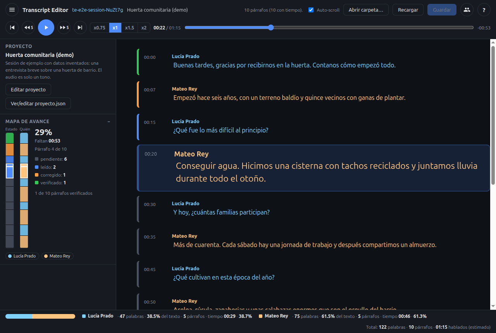

# Transcript Editor

[](LICENSE)

Aplicación de escritorio, local primero, para **corregir transcripciones de entrevistas mientras
escuchás el audio**. Abrís una carpeta de sesión, seguís el texto mientras suena, corregís en el lugar,
marcás párrafos como verificados y ves cuánto avanzaste. Nada sale de tu computadora.

English: [README.md](README.md)



## Qué hace

- **Barra superior fija con el reproductor**: retroceder 5 s, play/pausa, adelantar 5 s, párrafo
  anterior/siguiente, barra de posición y velocidad x0.75 / x1 / x1.5 / x2 (sin cambiar el tono).
- **Texto que acompaña al audio**: el párrafo activo se agranda y queda a la vista; clic en la hora
  para saltar; edición directa del texto.
- **Estados de párrafo** como barra de color: pendiente, leído, corregido, verificado.
- **Hablantes**: nombre completo, iniciales y color; opcionalmente el texto toma ese color.
- **Barra lateral**: panel de proyecto, mapa de avance de dos carriles (estado y hablante) y
  estadísticas (palabras, porcentaje de texto y tiempo hablado estimado por persona).
- **Atajos** con Ctrl (Cmd en macOS) y alternativas con Mayús para las combinaciones que reserva el sistema.
- **Archivo de proyecto** (`proyecto.json`) por carpeta: título, descripción, hablantes y nombres de los
  archivos de audio, texto y meta. Si falta, la app ofrece crearlo.
- **Transcripciones crudas** (`[HH:MM:SS] SPEAKER_01: texto`) se abren directo; tus cambios van a una copia
  limpia nueva y el original no se toca.
- **Recuerda dónde estabas**: último proyecto, posición del audio, velocidad y ventana.
- Interfaz en **español e inglés**.

## Instalación

Bajá la última versión desde [Releases](../../releases).

| Sistema                                        | Archivo                                                                                             |
| ---------------------------------------------- | --------------------------------------------------------------------------------------------------- |
| macOS Intel (por ejemplo una MacBook Air 2017) | `transcript-editor-<versión>-mac-x64.dmg`                                                           |
| macOS Apple Silicon                            | `transcript-editor-<versión>-mac-arm64.dmg`                                                         |
| Windows                                        | `transcript-editor-<versión>-win-setup-x64.exe` (o el portable `win-x64.zip`)                       |
| Linux                                          | `transcript-editor-<versión>-linux-x86_64.AppImage` o `transcript-editor-<versión>-linux-amd64.deb` |

Las versiones **todavía no están firmadas** (ver [docs/releasing.md](docs/releasing.md)):

- **macOS**: la primera vez, clic derecho sobre la app y _Abrir_, o ejecutá
  `xattr -dr com.apple.quarantine "/Applications/Transcript Editor.app"`.
- **Windows**: en el aviso de SmartScreen elegí _Más información_ y _Ejecutar de todas formas_.
- **Linux**: `chmod +x transcript-editor-*.AppImage` y ejecutalo.

## Primeros pasos

1. Abrí la app y tocá **Abrir sesión de ejemplo**, o **Abrir carpeta de sesión** y elegí una carpeta con
   un audio o video y un archivo de texto.
2. Si la carpeta no tiene `proyecto.json`, la app pregunta si querés crearlo y te deja elegir los archivos.
3. Tocá play o `Ctrl+Espacio`. Editá cualquier párrafo. Guardá con `Ctrl+S` (`Cmd+S` en macOS).

Guía completa: [docs/user-guide.es.md](docs/user-guide.es.md).

## Atajos

`Mod` es Ctrl, o Cmd en macOS. Las variantes con Mayús evitan combinaciones que usa el sistema.

| Acción                             | Principal         | Alternativa                   |
| ---------------------------------- | ----------------- | ----------------------------- |
| Guardar                            | `Mod+S`           |                               |
| Play / pausa                       | `Mod+Espacio`     | `Mod+Mayús+Espacio`           |
| Retroceder / adelantar 5 s         | `Mod+←` / `Mod+→` | `Mod+Mayús+←` / `→`           |
| Inicio del párrafo (o el anterior) | `Mod+↑`           | `Mod+Mayús+↑`                 |
| Próximo párrafo                    | `Mod+↓`           | `Mod+Mayús+↓`                 |
| Principio del audio                | `Mod+Inicio`      | `Mod+Mayús+Inicio`            |
| Marcar verificado                  | `Mod+Enter`       | `Mod+Mayús+Enter`             |
| Más lento / más rápido             |                   | `Mod+Mayús+,` / `Mod+Mayús+.` |

Más detalle: [docs/hotkeys.md](docs/hotkeys.md).

## Privacidad

Local primero. **Sin telemetría**, sin cuentas y sin llamadas a la nube. El audio y las transcripciones
quedan en la carpeta que elegís. La única conexión posible es la búsqueda de actualizaciones, y solo si la
pedís desde el menú Ayuda. La memoria de la app (proyectos recientes, posiciones) vive en la carpeta de datos
de la aplicación, nunca dentro de tus carpetas de sesión.

## Configuración

Los ajustes de la máquina están en `config.json` (carpeta de datos de la aplicación): idioma, recientes,
ventana, velocidad y barra lateral. La memoria por proyecto está en `state.json`. Si un archivo se daña se
guarda como `.bak` y se recrea. Con `TRANSCRIPT_EDITOR_DISABLE_UPDATE=1` se desactiva la búsqueda de
actualizaciones.

## Compilar desde el código

Requiere Node.js 22 (ver `.nvmrc`) y npm 10+.

```bash
npm ci
npm run dev
npm run lint && npm run typecheck && npm test && npm run build
npm run dist:dir
```

Más en [docs/development.md](docs/development.md) y [docs/architecture.md](docs/architecture.md).

## Herramientas opcionales

[`tools/transcribe`](tools/transcribe/README.es.md) tiene los scripts de Python (Whisper + pyannote) que generan
las transcripciones crudas y unen grabaciones en varias partes. La app no los necesita.

## Hoja de ruta y contribuciones

Mirá [ROADMAP.md](ROADMAP.md) y los issues. Las contribuciones son bienvenidas: [CONTRIBUTING.md](CONTRIBUTING.md).
Problemas de seguridad: en privado, ver [SECURITY.md](SECURITY.md).

## Licencia

[Apache-2.0](LICENSE).
