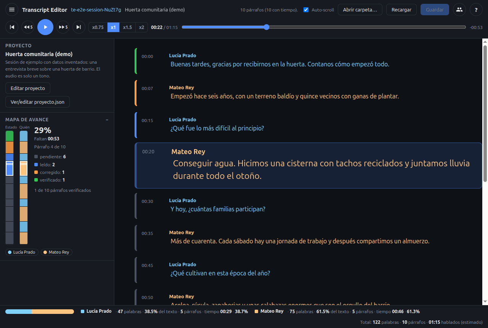

# Transcript Editor

[](LICENSE)

A local-first desktop app to **correct interview transcripts while you listen to the audio**.
Open a session folder, follow the text as the audio plays, fix mistakes in place, mark paragraphs as
verified, and see at a glance how far you are. Nothing leaves your computer.

Español: [README.es.md](README.es.md)



## Features

- **Fixed top bar with the player**: rewind 5 s, play/pause, forward 5 s, previous/next paragraph,
  seek slider and speed x0.75 / x1 / x1.5 / x2 (pitch preserved).
- **Transcript that follows the audio**: the active paragraph is enlarged and scrolled into view;
  click a time to jump there; edit text in place.
- **Paragraph states** shown as a coloured bar: pending, read, corrected, verified.
- **Speakers**: full name, initials and colour per speaker; optionally colour the text itself.
- **Sidebar gadgets**: project panel, two-lane progress map (state and speaker) and statistics
  (words, share of text and estimated speaking time per speaker).
- **Hotkeys** with Ctrl (Cmd on macOS), with a Shift alternative for combinations the OS reserves.
- **Project file** (`proyecto.json`) per session folder: title, description, speakers and the names of
  the audio / text / meta files. If it is missing the app offers to create it.
- **Raw transcripts** (`[HH:MM:SS] SPEAKER_01: text`) open directly; your edits go to a new clean copy
  and the original is never touched.
- **Remembers where you were**: last project, playback position, speed and window layout.
- **Spanish and English** interface.

## Install

Download the latest build from the [Releases](../../releases) page.

| System                                        | File                                                                                                 |
| --------------------------------------------- | ---------------------------------------------------------------------------------------------------- |
| macOS, Intel (for example a 2017 MacBook Air) | `transcript-editor-<version>-mac-x64.dmg`                                                            |
| macOS, Apple Silicon                          | `transcript-editor-<version>-mac-arm64.dmg`                                                          |
| Windows                                       | `transcript-editor-<version>-win-setup-x64.exe` (or the `win-x64.zip` portable build)                |
| Linux                                         | `transcript-editor-<version>-linux-x86_64.AppImage` or `transcript-editor-<version>-linux-amd64.deb` |

The builds are **not signed yet** (see [docs/releasing.md](docs/releasing.md)):

- **macOS**: right-click the app and choose _Open_ the first time, or run
  `xattr -dr com.apple.quarantine "/Applications/Transcript Editor.app"`.
- **Windows**: in the SmartScreen warning choose _More info_ then _Run anyway_.
- **Linux**: `chmod +x transcript-editor-*.AppImage` and run it.

## Quick start

1. Start the app and press **Open sample session** to try it, or **Open session folder** and pick a
   folder with an audio/video file and a text file.
2. If the folder has no `proyecto.json` the app asks whether to create it and lets you choose the files.
3. Press the play button or `Ctrl+Space`. Edit any paragraph. Save with `Ctrl+S` (`Cmd+S` on macOS).

Full walkthrough: [docs/user-guide.md](docs/user-guide.md) (Spanish: [docs/user-guide.es.md](docs/user-guide.es.md)).

## Hotkeys

`Mod` is Ctrl, or Cmd on macOS. The Shift variants avoid combinations the OS keeps for itself.

| Action                                   | Primary           | Alternative                   |
| ---------------------------------------- | ----------------- | ----------------------------- |
| Save                                     | `Mod+S`           |                               |
| Play / pause                             | `Mod+Space`       | `Mod+Shift+Space`             |
| Back / forward 5 s                       | `Mod+←` / `Mod+→` | `Mod+Shift+←` / `→`           |
| Start of paragraph (or the previous one) | `Mod+↑`           | `Mod+Shift+↑`                 |
| Next paragraph                           | `Mod+↓`           | `Mod+Shift+↓`                 |
| Start of audio                           | `Mod+Home`        | `Mod+Shift+Home`              |
| Mark verified                            | `Mod+Enter`       | `Mod+Shift+Enter`             |
| Slower / faster                          |                   | `Mod+Shift+,` / `Mod+Shift+.` |

More detail: [docs/hotkeys.md](docs/hotkeys.md).

## Project file

```json
{
  "version": 1,
  "titulo": "Community garden interview",
  "descripcion": "Free text",
  "archivos": { "audio": "unido.mp4", "texto": "unido.txt", "meta": "unido.meta.json" },
  "speakers": [
    { "id": "SPEAKER_00", "nombre": "Full Name", "iniciales": "FN", "color": "#7fd1ff" }
  ],
  "visualizacion": { "mostrar": "nombre", "colorearTexto": true }
}
```

The text file has one paragraph per line (`Label: text`); the meta file is a JSON array of
`{ seconds, speaker, estado }` aligned by line. Details: [docs/project-file.md](docs/project-file.md).

## Privacy

Local-first. The app has **no telemetry**, no accounts and no cloud calls. Your audio and transcripts
stay in the folder you choose. The only network request it can make is the update check, and only when
you ask for it from the Help menu. App memory (recent projects, positions) lives in the application data
folder, never inside your session folders.

## Configuration

Machine settings live in `config.json` in the application data folder (language, recent projects,
window size, speed, sidebar state). Session memory lives in `state.json` next to it. Both are plain
JSON; a damaged file is saved as `.bak` and recreated. Set `TRANSCRIPT_EDITOR_DISABLE_UPDATE=1` to
disable the update check entirely.

## Build from source

Requires Node.js 22 (see `.nvmrc`) and npm 10+.

```bash
npm ci
npm run dev          # opens the app on samples/demo-session
npm run lint && npm run typecheck && npm test && npm run build
npm run dist:dir     # unpacked build for this OS in apps/desktop/dist
npm run dist         # installers for this OS
```

More in [docs/development.md](docs/development.md) and [docs/architecture.md](docs/architecture.md).

## Optional: transcription pipeline

[`tools/transcribe`](tools/transcribe/README.md) contains the Python scripts (Whisper + pyannote) that
produce the raw transcripts and merge multi-part recordings. The app does not need them.

## Roadmap and contributing

See [ROADMAP.md](ROADMAP.md) and the GitHub issues. Contributions are welcome:
[CONTRIBUTING.md](CONTRIBUTING.md). Please read the [Code of Conduct](CODE_OF_CONDUCT.md).
Report security problems privately, see [SECURITY.md](SECURITY.md).

## License

[Apache-2.0](LICENSE).
